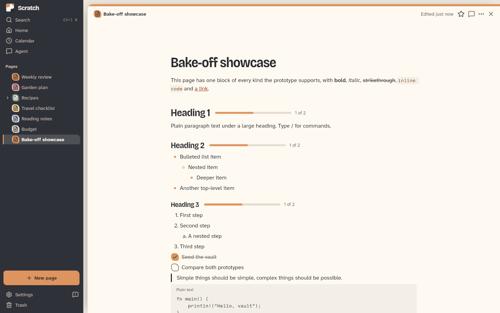
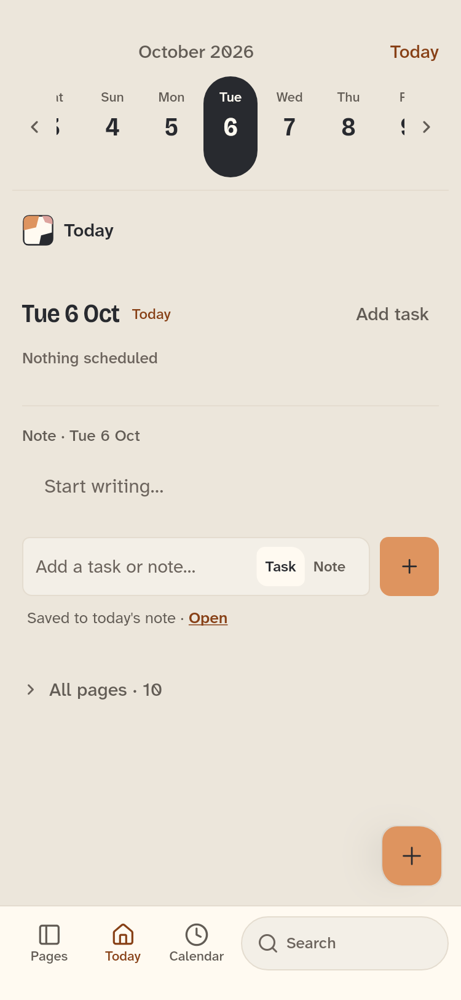
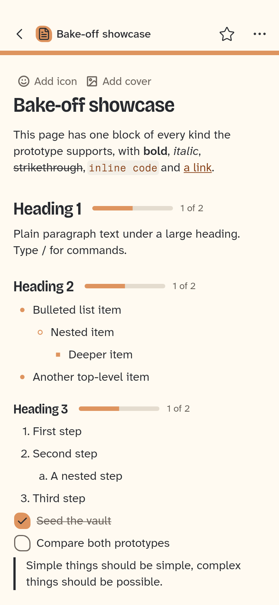
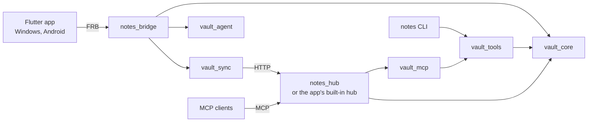

<p align="center">
  <picture>
    <source media="(prefers-color-scheme: dark)" srcset="design/readme/scratch-dark.svg">
    
  </picture>
</p>

<p align="center">
  How I always wanted to organise my life: notes, tasks, plans and project work in one place, local-first, with a hub I host myself and AI tools as first-class users.
</p>

> **Pre-alpha. Not ready for real use.** Scratch is unstable and changes often. Vault, sync and hub data formats may change without a migration path, so keep your own backups and expect to start over. There are no support, security or compatibility promises, and issues or pull requests may go unanswered.

<picture>
  <source media="(prefers-color-scheme: dark)" srcset="design/readme/shots/desktop-dark-page.png">
  
</picture>

## What it is

- **Pages and blocks.** Everything is a page made of blocks: text, headings, tasks, tables, code, embeds. You edit blocks, not markup.
- **Properties and views.** Any page can carry properties, and pages nest. A view block shows a page's children as a list, table, board, calendar or gallery, with each page drawn as a card. There are no separate databases to set up.
- **Local-first.** A vault is a folder on your device. Pages are Loro CRDT documents, indexed in SQLite for search, and the app works offline.
- **Your own hub.** Devices sync through a small server you run yourself: the hub built into the desktop app, or `notes-hub` on a server behind your own TLS and OIDC login. See [Running your own hub](wiki/sync/hub.md).
- **Agent tab.** A built-in agent, on [BubblePaw](https://github.com/BubbleBuffer/BubblePaw-Core), that reads and edits the vault with you and asks before running tools.
- **MCP access.** Claude, ChatGPT and other MCP clients use the vault through the hub, with scoped agent tokens or OAuth.
- **Windows, Android and a CLI.** A Windows app with an installer, an Android app, and the `notes` command line tool.

<p align="center">
  <picture>
    <source media="(prefers-color-scheme: dark)" srcset="design/readme/shots/mobile-dark-home.png">
    
  </picture>
  &nbsp;
  <picture>
    <source media="(prefers-color-scheme: dark)" srcset="design/readme/shots/mobile-dark-page.png">
    
  </picture>
</p>

## How it fits together



| Crate | Path | What it does |
| --- | --- | --- |
| `vault_core` | [crates/core](crates/core) | Vault storage, page CRDTs, the SQLite index and search |
| `vault_sync` | [crates/sync](crates/sync) | The sync client and the hub's sync routes, over HTTP |
| `notes_hub` | [crates/hub](crates/hub) | `notes-hub`, the server: sync, OIDC login, device tokens, `/mcp`, `/agent/ws` |
| `vault_tools` | [crates/tools](crates/tools) | Transport-independent vault tools, and the `notes` CLI |
| `vault_mcp` | [crates/mcp](crates/mcp) | The MCP server, over stdio and streamable HTTP |
| `vault_agent` | [crates/agent](crates/agent) | The BubblePaw agent over a vault: tools, sessions, approvals, AI tasks |
| `notes_agent_wire` | [crates/agent_wire](crates/agent_wire) | The agent wire format shared by `/agent/ws` and the bridge |
| `scratch_cli` | [crates/cli](crates/cli) | Runs a desktop vault's AI tasks without the app's UI |
| `notes_bridge` | [app/rust](app/rust) | The flutter_rust_bridge layer between the app and the crates |

The app is in [app/](app), and its add-ons (calendar, agent, schedule, board and others) are in [app/lib/addons](app/lib/addons). How each part works now is in the [project wiki](wiki/index.md).

**Documentation.** Start at the [project wiki](wiki/index.md). Good first pages are the [data model](wiki/core/data-model.md), the [Flutter app](wiki/app/app-state.md) and [sync and storage](wiki/sync/sync-and-storage.md).

## Build

You need stable Rust, Flutter 3.47.5 and `flutter_rust_bridge_codegen` 2.13.0. Windows builds need Visual Studio 2022 with ATL; Android builds need NDK 27.3.13750724 and JDK 17. The Rust workspace fetches its agent crates from [BubblePaw-Core](https://github.com/BubbleBuffer/BubblePaw-Core) on GitHub.

```sh
cargo install flutter_rust_bridge_codegen --version 2.13.0 --locked
cargo test --workspace --locked --exclude notes-tauri    # Rust tests

cd app && flutter pub get
flutter build windows --release                          # Windows app
flutter build apk --release                              # Android (debug-signed without a release keystore)

cargo build --release --locked -p vault_tools --bin notes   # notes CLI
cargo build --release --locked -p notes_hub                 # hub server (notes-hub)
```

The Windows installer is described in [Windows installer](wiki/releases/windows-install.md). The screenshots come from `app/test/golden_test.dart`; the wordmark is Bricolage Grotesque, outlined by `design/readme/wordmark.py`.

## Licence

`AGPL-3.0-or-later`; see [LICENSE](LICENSE). Bundled third-party components and their licences are listed in [THIRD_PARTY.md](THIRD_PARTY.md).

Scratch is made by [BubbleBuffer](https://0xbubbuff.de).
